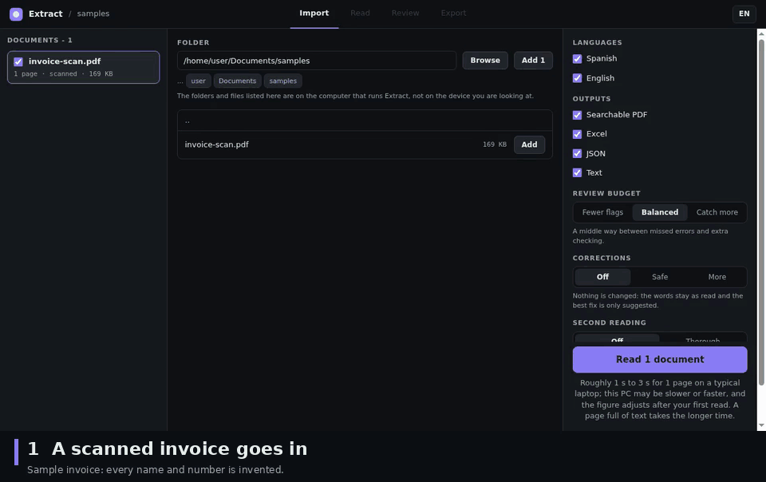
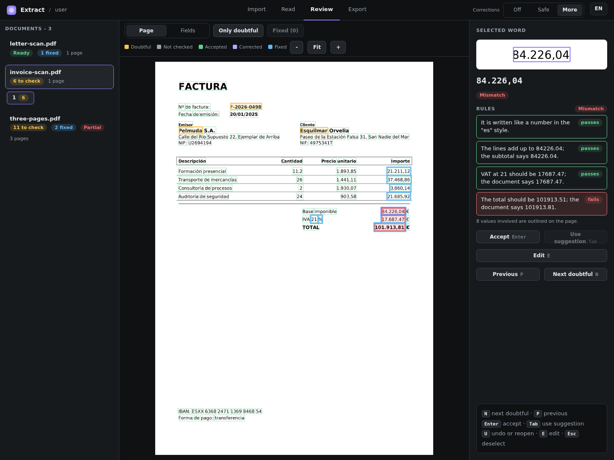

# Extract

 

Offline OCR for PDFs, scanned or digital, that also says which words and numbers are probably wrong.

Writing code against Extract, yourself or with an AI assistant? [AGENTS.md](AGENTS.md) has the calls for the common tasks on
one page.

<p align="center">
<picture>
  <source media="(prefers-reduced-motion: reduce)" srcset="docs/media/hero-still.png">
  <source srcset="docs/media/hero.webp" type="image/webp">
  
</picture>
</p>

*A real read of the sample invoice, Spanish only, corrections set to More. The total on this sample is deliberately wrong (101,913.81 where the rules give 101,913.51). Every name and number is invented. Waits are sped up, and the 32 s on the Read screen is the time of one page on a busy machine; the usual speed is in [Accuracy and limits](docs/accuracy.md#speed-and-memory).*


*A real read of the sample invoice (`invoice-scan.pdf` on the screen), Spanish only, corrections set to More: 6 to check, the three numbers whose rules fail and the three doubtful words. The selected word is the subtotal, `84.226,04`: it is Mismatch because the total rule fails, although its own lines rule passes. Every name and number is invented.*

## Why Extract

Plain OCR gives you text and a confidence you have to interpret. Extract gives every word a status (such as `ok`,
`doubtful` or `unscored`) and a reason when it doubts a word. It checks numbers with rules, such as the
check digits of a DNI or an IBAN and the arithmetic of an invoice, and marks a number `checked` only when a rule that
would break on any wrong digit passes. It changes nothing silently: a fix is a proposal with its reasons, and you can
undo it. It runs on your computer and sends nothing anywhere.

## What you get

- A searchable PDF (your pages untouched, plus an invisible text layer), JSON with every word and its box, an Excel
  workbook with the numbers and the invoice fields, and plain text.
- A review interface in the browser, and a Python library for the same work in code.
- Spanish and English, PDF only, on your own machine.

## Install

You need 64-bit Linux and Python 3.10 or newer. The installer downloads about 400 MB and takes a few minutes.

```console
$ git clone https://github.com/PabloMedinaBetancor/extract extract
$ cd extract
$ python3 scripts/install.py
```

Start the interface with `.venv/bin/python -m extract.ui`.

The test suite has been run on Linux with Python 3.10 only. Python 3.12 installs and reads the same way, and Windows is
untested. If the word lists are missing, `.venv/bin/python scripts/fetch_models.py --lists` builds them.
[Installation](docs/getting-started/installation.md) has the details, the offline bundle and where the models go.

## An example

From the root of the repository, on a sample invoice whose total is 30 cents off (every name and number in it is
invented):

```python
import extract

if __name__ == "__main__":
    doc = extract.read("tests/fixtures/mismatch.pdf")
    print(doc.status, len(doc.pages), "page")
    for word in doc.doubtful():
        print(word.id, word.text, word.suggestion)
    total = doc.invoice.total
    print(total.text, doc.field_status(total))
```

```text
# output
done 1 page
p1w11 Pelmuda None
p1w13 Esquilmar Esquivar
p1w4 F-2026-0498 None
101.913,81 mismatch
```

Three words are worth a look, and the total fails the invoice arithmetic. The [tutorial](docs/tutorials/invoice.md)
takes this sample apart step by step. The `if __name__ == "__main__":` line is required: the OCR runs in worker processes that
import your script again.

## Measured

Accuracy was judged on a sealed test of 772 pages (Spanish and English, 245 public-administration documents and 60
synthetic invoices), put aside before development and read for the published figures on code frozen beforehand. Every
figure has its interval and its conditions in [Accuracy and limits](docs/accuracy.md) and
[the measured tables](docs/MEASURED.md).

- The OCR reads about 97 of every 100 words right: word error rate 2.78 % in Spanish and 2.85 % in English.
- Reviewing the 5 % of words Extract flags catches 68.6 % of the wrong words in Spanish (95 % interval 49.7 to 86.5) and
  77.1 % in English (72.0 to 81.3).
- Of 519 numbers on 60 invoices that came out `checked`, none was wrong. The invoices are synthetic and were generated
  before 5.0.7, when their tax numbers and IBANs still passed their check digits (since 5.0.7 the generator writes
  identifiers that cannot exist), so they measure the rules, not real invoices.
- `safe` correction changed no word of the test. `more` removed a net 19.5 of every 100 wrong words in Spanish and 10.9
  in English with the default model, and 21.2 and 13.0 with the thorough mode; in one setting (English, default model)
  it broke 7.6 % as many words as it fixed, just over the 7.5 % limit set beforehand. That is reported as a miss.
- Speed: 3.6 s a page with one process of 4 threads and 3.2 s with two processes of two threads, on the development
  laptop. A two-core Celeron N4020 laptop read the three sample documents (5 pages) in about 50 s.

## Limits

- One OCR engine, Spanish and English, PDF only. A real word read wrong with high confidence can pass as fine, and
  `doubtful` is a likelihood, not a verdict.
- Only some numbers can be `checked`: Spanish DNI and NIE, IBANs whose national layout fixes every position as a letter
  or a digit, and invoice arithmetic. A CIF, a French or Italian IBAN and the withholding amount stay `unverified`.
- A page turned upside down or a quarter turn is not read properly, a scan under 100 dpi is read as it is, and the text
  layer of a digital PDF is trusted. A PDF with an owner password that restricts it (no copying, no changes) is read like
  any other, and its searchable PDF is written without those restrictions.
- Linux with Python 3.10 is what was tested. The Windows lock file was never run, and macOS has none.

[Accuracy and limits](docs/accuracy.md#limits) has them all, grouped, with the reason for each.

## Documentation

- [Installation](docs/getting-started/installation.md), then the [quickstart](docs/getting-started/quickstart.md) and the
  [tutorial](docs/tutorials/invoice.md).
- [How it works](docs/concepts/how-it-works.md), [number checks](docs/concepts/number-checks.md) and the
  [how-to guides](docs/how-to/batch-a-folder.md).
- [API reference](docs/reference/index.md), the [JSON format](docs/reference/json-format.md) and the
  [command line](docs/reference/command-line.md).
- [FAQ](docs/faq.md), [troubleshooting](docs/troubleshooting.md) and the [changelog](CHANGELOG.md).

To read the documentation as a site on your machine, follow
[Read the documentation as a site](docs/getting-started/installation.md#read-the-documentation-as-a-site).

## Support

Questions and bug reports: open an issue on GitHub. Work requests go through the author's Upwork profile.

## Licence and author

Extract is released under the MIT licence (`LICENSE`). The packages, models and word lists it uses keep their own
licences; [Licence and credits](docs/licence.md) lists them. All names, addresses and identifiers in the samples are
invented and cannot exist.

Version 5.0.7. Written by Pablo Medina and built with a team of AI agents he directed.
