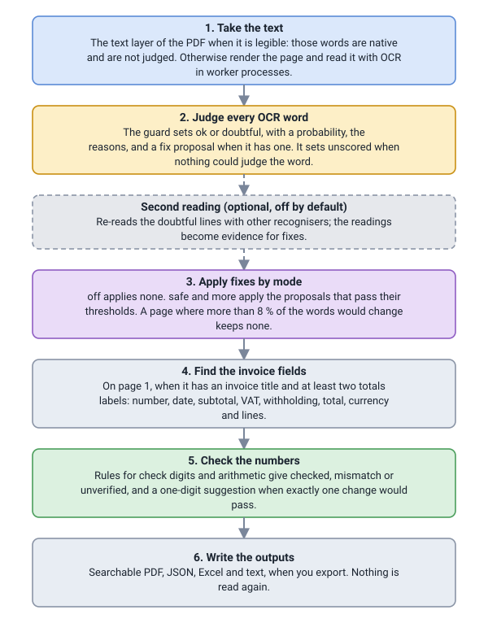
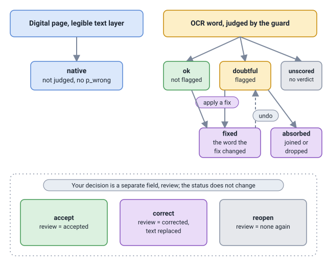

# How it works

What Extract does to a page, from the PDF to the output files, and what each status it gives means. Read it before you
rely on a status in code: a few of them mean less than they seem to.



## From the PDF to the words

Extract first looks at each page without any OCR. A page has a legible text layer when it holds at least 80 non-space
characters, at least 80 % of them ordinary characters, and, if it has 12 or more words of three letters or more, at least
35 % of those words are in the word lists. Its words are then taken from the layer with the status `native`: nothing was
recognised, so they have no confidence and are never `doubtful`. Extract trusts such a layer, and a layer that looks
legible but differs from what is printed is not detected. `extract.inspect` tells you beforehand: `digital` when every page
has a usable layer, `scanned` when none does, `mixed` otherwise.

Any other page is read with OCR. It is rendered at the resolution of its own scan, taken from the widest image that covers
at least half the page and kept between 100 and 300 dpi; a page with no such image is rendered at 200 dpi, and no side is
longer than 3,000 pixels. A scan under 100 dpi is read at 100 and gets a page note with its real resolution, since nothing
in its words says whether it read well. Words come out in reading order, which follows the lines across the page, so a page
with two columns is read across both.

### Worker processes

OCR runs in up to two worker processes, which Python starts with `spawn`: each one imports your main script again. That is
why a script that reads keeps its calls to `extract` under `if __name__ == "__main__":`. Without the guard, the worker that
imports the script runs the read again and stops with an error on its standard error, the page comes out `unreadable` with
the reason `page.reason.render_failed`, and no exception reaches your code; [Troubleshooting](../troubleshooting.md) shows
the symptom.

Each worker is budgeted about 1,500 MB with OpenVINO and 700 MB with ONNX Runtime, with 800 MB kept for the rest of the
system; with fewer than 600 MB free, no worker starts until memory recovers. A worker is replaced after 120 pages, or sooner
when its memory passes about 1.4 GB (a worker is checked only after a chunk of up to four pages, measured to add up to 190 MB, so that is 200 MB under the 1,600 MB bound of [Accuracy and limits](../accuracy.md#speed-and-memory)), so a long run stays as fast at the end as at the start. Digital pages and pages in the
page cache, keyed by the hash of the file, the page, the resolution and the engine, are handled in your own process: a
second read of a file with the same work folder costs no OCR.

### When a page cannot be read

A page is `unreadable` when fewer than 25 words came out, when the mean word confidence is under 0.65, or when it could not
be rendered or its worker died twice. Its words are kept as `unscored`, its numbers are never `checked`, and the document is
`partial`: it is returned, not raised.

## The guard

The guard scores each OCR word from the confidence of its characters, a lookup in the word lists of the languages you
chose, a character model and the words around it. The result is a status (`ok` or `doubtful`), `p_wrong` (the calibrated
probability that the word is wrong), the reasons, and, when it has one, a proposed fix. `p_wrong` is a better guide than
`conf`, the OCR's own confidence, because it combines that confidence with the rest.

How many words it flags depends on the review budget, `Options.review`: `fewer`, `balanced` or `more`. Each picks a fixed
threshold, set on the development pages so that about 3, 5 or 8 percent of their words are flagged, and words with digits
use a lower one. It is not a quota: a damaged page gets more flags and a clean page almost none. The guard cannot judge a
page of more than 5,000 words, nor words without a usable confidence; those words are `unscored`.

A proposed fix is applied only in a correction mode you choose, and the optional second reading reads the doubtful lines
again before the guard decides. Both are on [Corrections and the second reading](corrections.md).

## Invoice fields and numbers

If page 1 has an invoice title (`factura` or `invoice`, allowing for a misread letter or two) in its top third and at least
two totals labels (subtotal, `base imponible`, VAT, `iva`, total), the document is an `invoice`, and Extract looks on page 1
for the number, date, subtotal, VAT pairs, withholding, total, currency and the lines of the table. Each field is a cell
with its text and the words it came from, or `None` when it was not found: a field is never guessed. Only page 1 is read
for fields. Anything else is `generic`, and `Document.invoice` is `None`.

Every word with a digit then goes through the number rules, as does every IBAN, even one written in groups;
[Number checks](number-checks.md) says how a number becomes `checked`, `mismatch` or `unverified`. Last, `Document.export`
writes the searchable PDF, the workbook, the JSON and the text. It reads no page again and never loads the OCR models, so
an export after corrections takes seconds.

## Statuses

Every word, page, number and document carries a status that says how far to trust it.

| Word status | Meaning |
|---|---|
| `native` | Taken from the text layer of a digital PDF. It was not scored: no `conf`, no `p_wrong`, never `doubtful`. |
| `ok` | Read by OCR and not flagged. It means "not flagged", not "verified". |
| `doubtful` | Read by OCR and flagged as probably wrong, with its reasons and sometimes a suggestion. |
| `unscored` | Nothing could judge the word: it was read with no guard (`Reader(guard=False)`), the guard failed, the page has more than 5,000 words or no usable confidence, or the page is `unreadable`. Extract does not present it as fine. |
| `fixed` | A fix of the guard was applied to this word, and its first text is in `original`. It appears only with `correct` set to `safe` or `more`. |
| `absorbed` | The word was joined into a neighbour or dropped by a fix. Its text is empty. Same condition as `fixed`. |

| Kind | Values |
|---|---|
| Page | `native` (the text layer was used), `ocr` (rendered and read), `unreadable` (its `reason`, such as `page.reason.few_words`, says why, and `error` holds the text of a failure) |
| Number | `checked` (a rule that would break on any wrong digit passed, and none failed), `mismatch` (a rule failed: some digit is wrong somewhere, not necessarily the one suggested), `unverified` (no verifying rule passed and none failed: not wrong, not confirmed) |
| Document | `done` (every page was read), `partial` (at least one page is `unreadable`; `doc.unreadable_pages` gives their 1-based numbers) |



A doubtful word is a likelihood, not a verdict: read it as "look at this". Flagging generously is what lets most errors
be caught, and [Accuracy and limits](../accuracy.md) says how many flagged words are really wrong. A word you already
decided is never touched by a fix, and `undo` returns a fixed word to the status the guard gave it. The interface calls
the guard the word checker.

## Your decisions: `review`

Accepting or correcting a word does not change its status. It sets a separate field, `review`, which is `None` while the
word is undecided, `"accepted"` after `accept`, and `"corrected"` after `correct`. The block opens `invoice.extract.json`,
the saved reading of a sample, made as [The samples the examples use](../reference/index.md#the-samples-the-examples-use) shows.

```python
import extract

doc = extract.load("invoice.extract.json", options=extract.Options(work_dir="work"))
word = doc.doubtful()[0]
print(word.id, word.text, word.status, word.review)
doc.accept(word.id)
word = doc.word(word.id)
print(word.status, word.review, len(doc.doubtful()))
```

```text
# output
p1w11 Pelmuda doubtful None
doubtful accepted 2
```

An accepted word keeps `status == "doubtful"` and has `review == "accepted"`, a normal state. `doubtful()` returns only
the words whose `review` is `None`, so the accepted word left the list because it was decided, not because its status
changed: test `word.review` to know whether a word was decided. `doubtful()` also includes the `unscored` words, after the
`doubtful` ones; for only the flagged ones, filter: `[w for w in doc.doubtful() if w.status == "doubtful"]`. And accepting a
word never makes a number `checked`: only the rules do that.

## Next

[Number checks](number-checks.md) explains how a number gets its status. The [data types](../reference/data-types.md)
page lists every field of `Word`, and [Review doubtful words](../how-to/review-doubtful-words.md) shows the review loop in
code.
