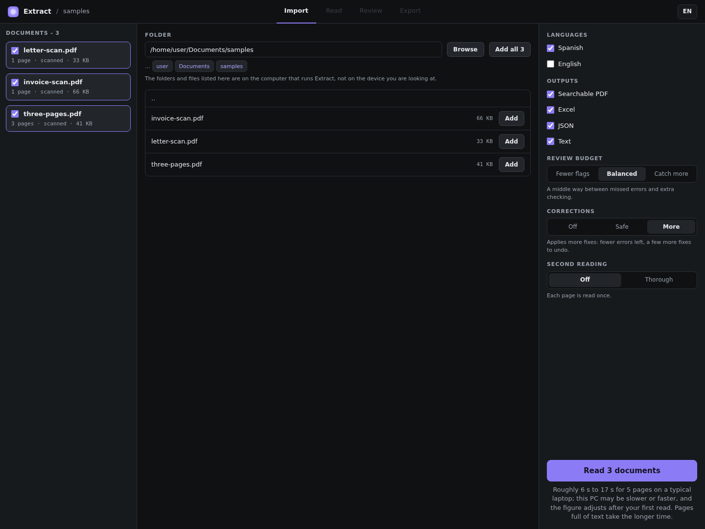
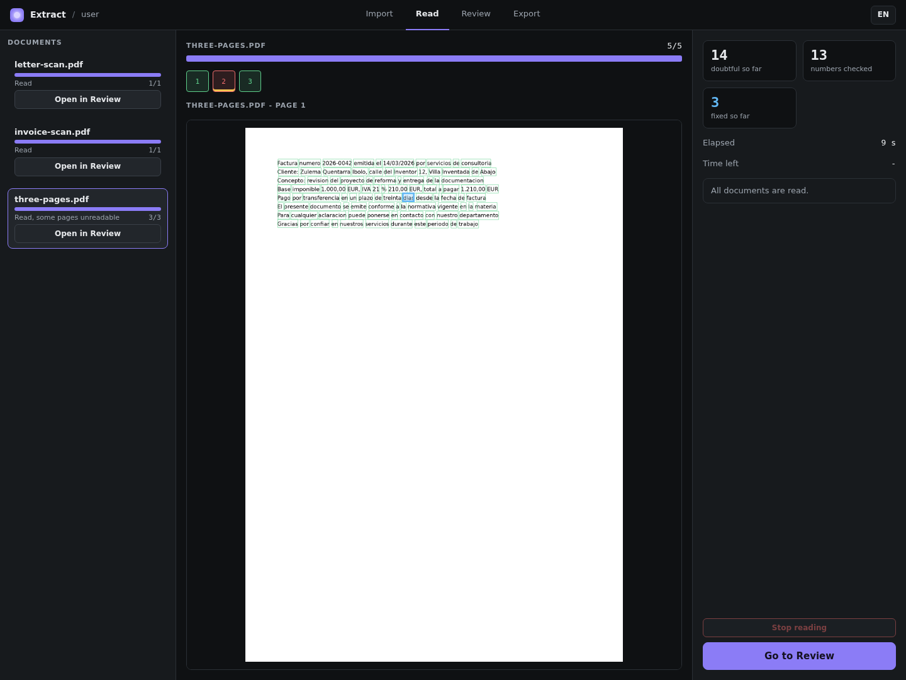
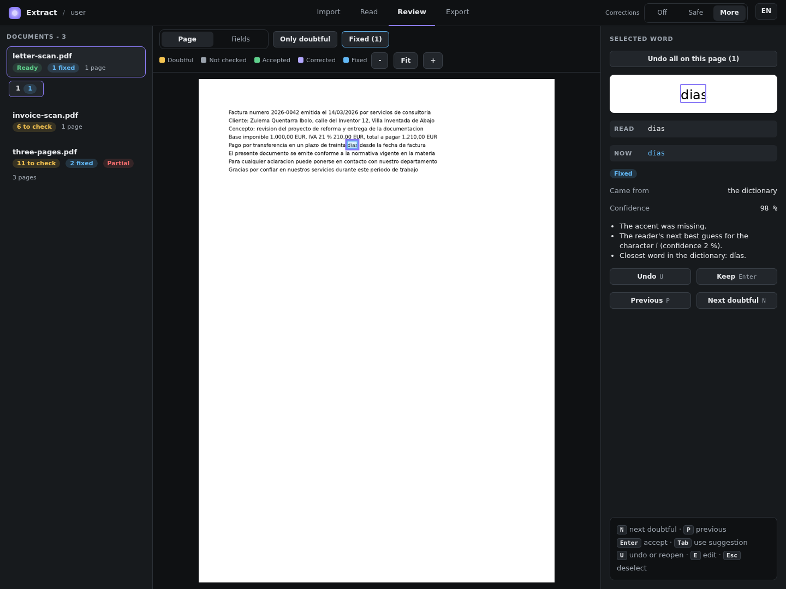
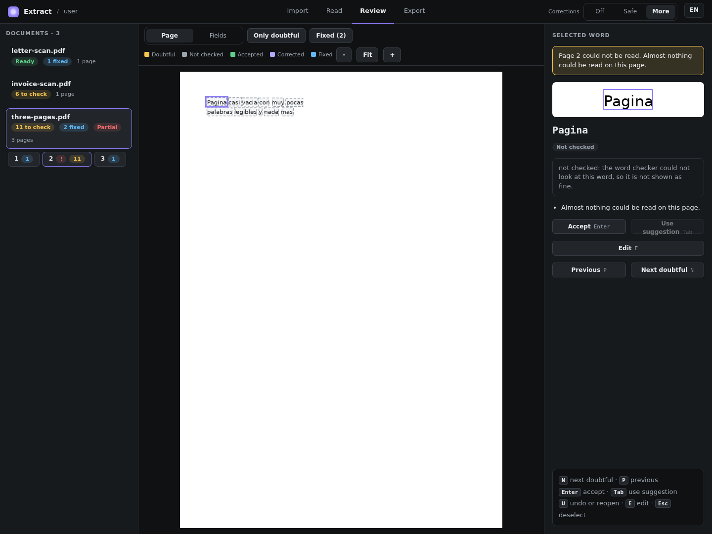
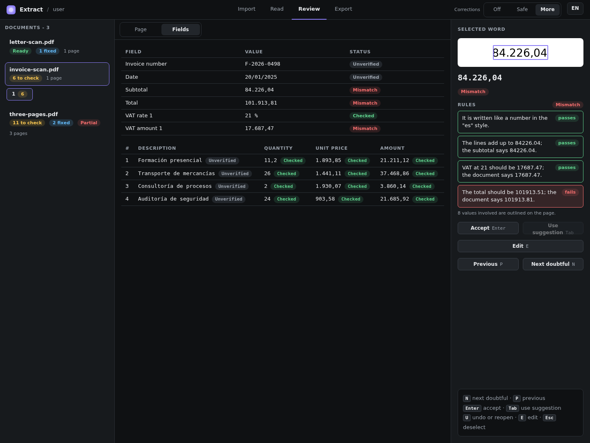
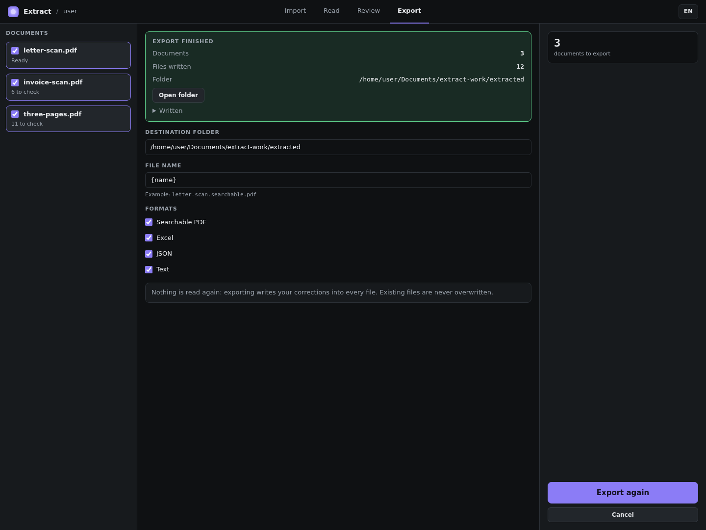

# Interface

The interface is a web page that runs on your own computer: you start it with `.venv/bin/python -m extract.ui`, and it reads PDFs, shows the words and numbers that are probably wrong, lets you
decide each one, and writes the result. The options of that command are on [Command line](command-line.md). This page names every screen and control as the interface shows it; to do the
same from code, see the [API reference](index.md).

The pictures come from a real read of the three sample documents, with the default OCR models, Spanish selected and
Corrections set to *More*. On the screens the samples are called `letter-scan.pdf`, `invoice-scan.pdf` and
`three-pages.pdf` (`scan.pdf`, `invoice.pdf` and `damaged.pdf` in the examples of these docs); every name, address and
identifier in them is invented.

## The four screens

The tabs at the top move between **Import**, **Read**, **Review** and **Export** at any time; a tab is dim until it has
something to show. The left column lists your documents on every screen, and the chip on the right of the top bar, `EN`
or `ES`, switches the interface language.

### Import

*The Import screen with the three sample documents added, Spanish ticked and Corrections set to More.*

Type or paste a folder in **Folder** and press **Browse**: it lists the sub-folders and PDF files, each file with an
**Add** button, and **Add all** adds every PDF of the folder. Extract opens only folders inside your home folder, on the
computer that runs it. Each added document shows its page count, its kind (*scanned*, *digital* or *mixed*), its size and
a checkbox: tick the documents to read. A file that cannot be read (password protected, damaged, not a PDF) is not added,
and a box names it and says why. Two files with exactly the same content count as one document.

| Setting | Choices | What it does |
|---|---|---|
| **Languages** | Spanish, English | The languages of the documents: they decide which word lists the guard (the interface's word checker) compares against. |
| **Outputs** | Searchable PDF, Excel, JSON, Text | The files the export writes. |
| **Review budget** | Fewer flags, Balanced, Catch more | How many words the guard flags: fewer to check, or fewer errors slipping through. |
| **Corrections** | Off, Safe, More | *Off* changes nothing and only suggests; *Safe* fixes control digits (DNI/NIE, IBAN) and no other word; *More* applies more fixes, with a few more to undo. |
| **Second reading** | Off, Thorough | *Thorough* reads the doubtful lines and zones again with a better recogniser, at a cost in time and memory. It needs the extra reader models (`python3 scripts/fetch_models.py --all`): without them the screen says so and **Read** stays off. |

The text under each setting says what the choice does and costs on this computer; the settings behind these choices are
[`Options`](options.md#options). The **Read** button says how many documents it will read, and the line under it gives
the time as a range, the short figure for pages with little text and the long one for pages full of text. It follows the
speed of this computer after the first read.

### Read

*The end of a real read of the three sample documents. Page 2 of `three-pages.pdf` is marked red: it could not be read.*

Each document has a card with a progress bar and its state: *Waiting*, *Reading*, *Read*, *Read, some pages unreadable*,
*Not read (failed)*, *Not read* or *Stopped, not kept*. The middle shows a tile for each page and the page itself; the
right column counts *doubtful so far*, *numbers checked* and *fixed so far*, with *Elapsed* and *Time left*.
**Review what is read so far** opens the first documents in **Review** while the others are read, and **Go to Review**
replaces it at the end. **Stop reading** halts the read within a couple of seconds: the documents already read are kept,
and the one being read is marked *Stopped, not kept*, with none of its pages. Reading a file again replaces its open copy,
and Extract asks first if you had decided words in it.

### Review

*The sample invoice on Review. The subtotal is selected: it is Mismatch because the total rule fails, and the rules on the
right show which one.*

On the left, each document has a badge: *to check* with a count in amber, **Ready** in green when nothing is left,
**Partial** in red when some pages could not be read (never *Ready*), *fixed* with a count in blue, and *without 2nd
reading* when its second reading failed on some pages. In the middle, the page with every word outlined in the colour of
its state, and a toolbar: **Page** and **Fields** (the invoice fields; off for a document that is not an invoice),
**Only doubtful**, **Fixed** (the list of fixes), and `-`, **Fit** and `+` to zoom.

| Colour | State |
|---|---|
| Yellow | *Doubtful*: probably wrong, check it. |
| Grey, dashed | *Not checked*: the guard could not look at the word. It is never shown as fine. |
| Red | A number whose rules fail. Such numbers come first among the things to check. |
| Green | *Accepted*: you confirmed it. |
| Purple | *Corrected*: you typed a correction. |
| Blue | *Fixed*: Extract applied a correction (only when Corrections is on). |

On the right, *Selected word*: the word cut from the page, what was read, its state, how likely it is to be wrong, the
*Suggestion* if it has one, and the reasons in plain words, such as *Not in the dictionary*. For a number the panel lists
its *Rules*, each *passes* or *fails*; press one to outline the values it involved. For a word that Extract fixed it shows
*Read* and *Now*, *Came from* and *Confidence*, and **Undo all on this page** takes back every fix of the page.

*Corrections set to More: Extract fixed `dias` to `días`, with the dictionary as the source of the fix.*

| Key | Button | What it does |
|---|---|---|
| `N` / `P` | **Next doubtful** / **Previous** | Moves to the next or previous word to check. |
| `Enter` | **Accept**, or **Keep** for a fix | The word is right as it is. A failing number accepted as it stands leaves the list; its status stays *Mismatch*. |
| `Tab` | **Use suggestion** | Takes the suggestion when the word has one; otherwise `Tab` moves between buttons. |
| `E` | **Edit** | Type the correct word, then `Enter` to keep it or `Esc` to cancel. |
| `U` | **Reopen**, or **Undo** for a fix | Takes a decision back (a word you typed gets its read text back), or undoes a fix. |
| `Esc`; `-`, `+`, `0` | | Deselect; zoom out, zoom in, fit the page. |

The keys work on this screen only, and not while you type in a box. A page that could not be read shows *Page 2 could not
be read* and the reason, a page under 100 dpi or turned a quarter shows its note, and a page whose fixes were withheld says
so. Your decisions never make a number *Checked*: after an edit the rules run again, and only they decide.

*Page 2 of `three-pages.pdf` has almost nothing on it, so its words are marked Not checked instead of passing as fine.*

**Fields** shows the invoice number, date, subtotal, withholding rate, withholding, total and each VAT rate, base and
amount, then the lines, each with a *Value* and a *Status* (*Checked*, *Mismatch* or *Unverified*); click a row to see its
word on the page.

*The Fields tab of the sample invoice: the quantities, prices and amounts of the lines are Checked, and the amounts the
failing total rule involves are Mismatch.*

The **Corrections** switch at the top right of the screen (*Off*, *Safe*, *More*) changes the correction mode of the open
document at once, from the fixes proposed at the read, without reading it again
([`Document.set_mode`](document.md#documentset_mode)).

### Export

*After a real export of the three sample documents, with the four formats ticked.*

Tick the documents, then choose the **Destination folder** (by default `extracted` inside the work folder), the **File
name** pattern (`{name}` is the PDF's name without its extension and `{date}` today's date, such as `2026-10-12`) and the
**Formats**, and press **Export**. Nothing is read again, so it takes seconds. Every file is checked after it is written,
and no file is overwritten: a taken name gets `-2`, `-3`. A box then says *Export finished*, with the number of files, the
folder and an **Open folder** button, and names any document under *Not exported*. The *Corrections* sheet of the Excel
file lists every change to the text, by Extract or by you; [`Document.export`](document.md#documentexport) describes the
files.

## Reloads, tabs and saved readings

The documents that were read live in the program, not in the page: a reload keeps them, with the list of files, the
folder and your choices, and a page opened during a read shows that read. A change made in one tab shows in another as
soon as you go back to it. `.venv/bin/python -m extract.ui --open invoice.extract.json` starts with that saved reading
open in **Review**; the PDF has to be next to the JSON.

The layout follows the size of the window: below 1100 px wide the columns stack, and on a touch screen **Previous** and
**Next doubtful** replace the keys. The interface answers only on the computer that runs it (`127.0.0.1`), so a tablet or
a phone can show it only through a remote-desktop session; the small layouts were checked in browser windows of those
sizes, not on a real tablet or phone.

---

[Back to the reference index](index.md); [the command line](command-line.md).
