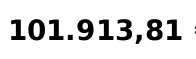

# Tutorial: an invoice

This tutorial reads a sample invoice whose total is 30 cents off, decides its doubtful words, finds out why the total
fails, and writes the workbook. At the end you know what `doubtful`, `mismatch` and `checked` mean in practice. It takes
about fifteen minutes, most of it reading; you need Extract [installed](../getting-started/installation.md) and a terminal
in the repository folder.

The sample is `tests/fixtures/mismatch.pdf`: one page, an invoice with four lines, a subtotal, 21 % VAT and a total. Every
name, number and IBAN in it is invented. The total as printed is `101.913,81`, and the figures above it add up to
`101.913,51`. `examples/invoice.py` holds this page in one script.

## Read it

```python
import extract

if __name__ == "__main__":
    doc = extract.read("tests/fixtures/mismatch.pdf", options=extract.Options(work_dir="work"))
    print(doc.name, doc.status, doc.doc_type, doc.locale)
    for word in doc.doubtful():
        reasons = [reason.key.rsplit(".", 1)[-1] for reason in word.reasons]
        print(word.id, word.text, round(word.p_wrong, 2), word.suggestion, reasons)
```

```text
# output
mismatch.pdf done invoice es
p1w11 Pelmuda 0.19 None ['not_in_dictionary', 'low_char_conf', 'neighbours_unusual']
p1w13 Esquilmar 0.12 Esquivar ['not_in_dictionary', 'low_char_conf', 'neighbours_unusual']
p1w4 F-2026-0498 0.04 None ['not_in_dictionary', 'mixed_letters_digits', 'neighbours_unusual']
```

`done` means every page was read. `doc_type` is `invoice` and `locale` is `es`, which means the amounts are written like
`1.234,56`. The read gives the three words that need a decision, the likeliest to be wrong first, with `p_wrong`, the
guard's probability that the word is wrong.

Run it with `.venv/bin/python`, and keep the `__main__` line: the OCR runs in worker processes that import your script
again. The blocks that follow continue in the same session. The `work_dir` option puts what the read and your decisions
write in a folder named `work`, so that you can look at it later.

In the interface, the three words are yellow boxes on **Review**: press `N` to jump to the next.


*The sample on **Review**, as a real read draws it. The selected word is the subtotal, `84.226,04`: it is Mismatch because the total rule fails, although its own lines rule passes. The screen was read in Spanish only; the code on this page reads in both languages.*

## Decide the three words

All three are doubtful for the same reasons: none is in the dictionary, and the words around them are unusual. They are an
invented company name, an invented customer name and an invoice number, and nothing is wrong with them. To decide, look at
the word cut from the page: the picture at the top of the right panel in the interface, `doc.word_crop(id)` (a PNG) in
code.

The suggestion for `Esquilmar` is `Esquivar`, the nearest word in the dictionary, and the guard gave it a probability of
0.009 of being right: a suggestion is a candidate, not a verdict. The page says `Esquilmar`, so you accept the word as it
stands:

```python
for word in doc.doubtful():
    doc.accept(word.id)
print(len(doc.doubtful()), doc.word("p1w11").status, doc.word("p1w11").review)
```

```text
# output
0 doubtful accepted
```

The list is empty. The word is still `doubtful` and its `review` is `accepted`: your decision does not rewrite what the
guard said, it records what you decided. In the interface, `Enter` accepts the selected word and `Tab` takes the
suggestion.

Two other statuses matter here. `ok` means the guard looked at a word and did not flag it, not that
the word is verified: all 95 words of `doubtful.pdf` are `ok`, and its `doubtful()` is empty. `unscored` means nothing
could judge the word: page 2 of `unreadable.pdf` gives fewer than 25 words, so the page is `unreadable`, its 11 words are
`unscored` and listed by `doubtful()`, and the document comes back `partial` instead of raising.
[How it works](../concepts/how-it-works.md#statuses) lists every status.

## The numbers

Words are one half of the document. The other is its numbers, and for each Extract runs the rules of
[Number checks](../concepts/number-checks.md):

```python
from collections import Counter

print(Counter(number.status for number in doc.numbers))
for number in doc.numbers:
    if number.status == "mismatch":
        print(number.text, [(rule.key.rsplit(".", 1)[-1], rule.result) for rule in number.rules])
```

```text
# output
Counter({'checked': 13, 'unverified': 11, 'mismatch': 3})
84.226,04 [('number_format', 'pass'), ('lines_sum', 'pass'), ('vat_amount', 'pass'), ('total', 'fail')]
17.687,47 [('number_format', 'pass'), ('vat_amount', 'pass'), ('total', 'fail')]
101.913,81 [('number_format', 'pass'), ('total', 'fail')]
```

Thirteen numbers are `checked`: a rule that would break on any wrong digit passed for each. Eleven are `unverified`:
nothing contradicts them and nothing confirms them. Three are `mismatch`, and the three fail the same rule, `total`,
because it involves all of them: the subtotal plus the VAT should be the total. The subtotal also passes `lines_sum` (the
four lines add up to it), and the VAT passes `vat_amount` (21 % of the subtotal). A `mismatch` says that the numbers do not
agree. It does not say which of them is wrong.

The invoice fields of page 1 are in `doc.invoice`, and `doc.field_status` says how far to trust each:

```python
invoice = doc.invoice
for line in invoice.lines:
    print(line.description.text, line.amount.text, doc.field_status(line.amount))
print(invoice.subtotal.text, doc.field_status(invoice.subtotal))
print(invoice.total.text, doc.field_status(invoice.total))
```

```text
# output
Formación presencial 21.211,12 checked
Transporte de mercancías 37.468,86 checked
Consultoría de procesos 3.860,14 checked
Auditoría de seguridad 21.685,92 checked
84.226,04 mismatch
101.913,81 mismatch
```

All four lines are `checked`: for each, quantity times unit price is the amount, to the cent. In the interface the
**Fields** tab shows this table, and a click on a row shows the word on the page.

## Why the total fails

The rule keeps what it expected and what it found:

```python
total = next(number for number in doc.numbers if number.text == "101.913,81")
failed = next(rule for rule in total.rules if rule.result == "fail")
print(failed.key, failed.params["expected"], failed.params["found"])
print(total.suggestion)
```

```text
# output
checks.rule.total 101913.51 101913.81
DigitSuggestion(position=8, old='8', new='5', verified=True, rule='checks.rule.total')
```

The subtotal, `84.226,04`, plus the VAT, `17.687,47`, is `101.913,51`; the page says `101.913,81`. Extract offers a way
out: change the digit at position 8, an `8`, to a `5`. The suggestion is `verified` because the rule passes with that
change and with no other single-digit change of this number.

A verified fix says that the figures add up with that digit; it does not say that the digit is the printed one. Look at
the page:



The page says `101.913,81`, so the OCR read it right, and the error is in the invoice itself: the sample's total is 30
cents off as printed. That is the case this sample was made for. Had the picture shown `101.913,51`, the OCR would have
misread a 5 as an 8, and applying the suggestion would be a plain fix. Here the printed value is the record, the decision
is `accept`, and with a real invoice you would ask its issuer for a corrected one.

## Apply the suggestion

To see what a correction does, apply the suggestion here. With a real invoice you would not: the workbook should say what
the page says.

```python
doc.use_suggestion("p1w75")
word = doc.word("p1w75")
print(word.text, word.original, word.review, word.status)
print(doc.field_status(doc.invoice.total), doc.field_status(doc.invoice.subtotal))
print(Counter(number.status for number in doc.numbers))
```

```text
# output
101.913,51 101.913,81 corrected ok
checked checked
Counter({'checked': 16, 'unverified': 11})
```

The word now reads `101.913,51`, and `original` keeps `101.913,81`. The rule `total` passes, so the total is `checked`,
and so are the subtotal and the VAT, which failed only because of it. Your decision is in the work folder, one line for
each word you decided:

```python
import json
from pathlib import Path

last = json.loads(Path("work/corrections.jsonl").read_text(encoding="utf-8").splitlines()[-1])
print({key: last[key] for key in ("word", "original", "corrected", "action")})
```

```text
# output
{'word': 'p1w75', 'original': '101.913,81', 'corrected': '101.913,51', 'action': 'correct'}
```

The log also records the three words you accepted, each with its time. `doc.reopen("p1w75")` takes the correction back:
the word has the text it was read with again, and the rules run again on it.

## Export to Excel

```python
import openpyxl

path = doc.export("out/", ("xlsx",))[0]
book = openpyxl.load_workbook(path)
print(book.sheetnames)
for row in book["Fields"].iter_rows(values_only=True):
    if row[0] == "total":
        print(row[:4])
for row in book["Corrections"].iter_rows(min_row=2, values_only=True):
    print(row[:5])
```

```text
# output
['Numbers', 'Fields', 'Review', 'Corrections']
('total', 101913.51, '101.913,81', 'checked')
(1, 'edit', 'user', '101.913,81', '101.913,51')
```

The workbook has four sheets. **Numbers** lists every number with its value, kind, status and the rules, in words.
**Fields** has the invoice fields: `Value` is the number you decided on, and `As read` is the text of the page, which your
correction does not change. **Review** lists the words still to decide, empty after your three decisions. **Corrections**
has what you changed. `openpyxl` is a dependency of Extract, so it is installed.

## Next

[Number checks](../concepts/number-checks.md) lists the rules and says which numbers can be `checked`.
[Batch a folder](../how-to/batch-a-folder.md) reads a folder of invoices into one workbook, and
[Review doubtful words](../how-to/review-doubtful-words.md) does this review in a script.
